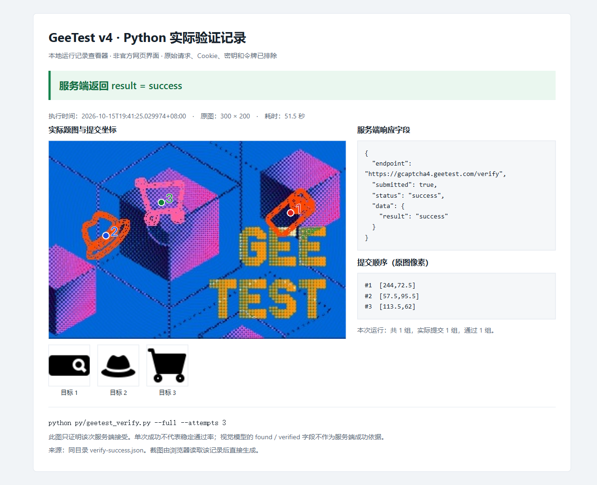

# 极验 v4：POW、AES、RSA 与 `/verify`

这个案例用 Python 还原极验 `gcaptcha4` 的取题、POW、点击坐标编码、`w` 参数生成和验证提交链路。协议计算包含纯 Python 实现，运行时不需要浏览器或 Node.js；图标定位仍依赖外部视觉模型，并使用本地候选匹配辅助判断，**不是纯离线图像识别**。

当前验证范围是 `icon` 点选题、`pt=1`。仓库提供真实 `/verify` 成功记录与对应截图；这证明该次完整链路被服务端接受，不代表任意题型可用，也不代表稳定通过率。`pt=0` 只有离线编码检查，尚未确认线上接受。

## 查看真实通过证据



上图是**本地运行记录查看器的浏览器截图，非官方页面截图**。它展示 Python 实际调用 `/verify` 后保存的脱敏结果，只有实际返回成功才显示“通过”。对应数据见 [`evidence/verify-success.json`](evidence/verify-success.json)，运行时间与参数以该记录为准。截图和 JSON 不包含 API key、Cookie、可复用的验证票据或原始请求明文。

确认通过需要同时满足：本组已提交、响应 `status="success"`，以及响应中的 `data.result="success"`。HTTP 200、模型返回坐标、`found=true` 或本地 `verified=true` 都不等于服务端通过。

## 快速运行

建议使用 Python 3.11 或更新版本，代码语法最低要求为 Python 3.10。以下命令从仓库根目录开始：

```powershell
cd geetest
python -m pip install -r requirements.txt
python .\py\geetest_verify.py --selftest
```

`--selftest` 只检查本地算法，不访问网络，也不调用视觉模型。全流程运行前，需要配置自己的题目和视觉模型服务：

| 环境变量 | 何时需要 | 含义 |
|---|---|---|
| `GEETEST_CAPTCHA_ID` | 在线取题与提交 | 当前测试页面使用的 `captcha_id`；也可通过 `--captcha-id` 指定 |
| `VLM_BASE_URL` | 调用图像定位 | 支持多图输入的 OpenAI 兼容 API 基址，程序会追加 `/chat/completions` |
| `VLM_API_KEY` | 调用图像定位 | 自己的模型服务凭据；代码不内置 key |
| `VLM_MODEL` | 调用图像定位 | 该服务支持的视觉模型名；也可通过 `--model` 指定 |

可选项也列在配置示例中：`GEETEST_CHALLENGE` 为空时，每次取题生成新 UUID；`GEETEST_COOKIE` 默认留空；`GEETEST_REFERER` 用于指定页面来源，默认是极验官网。

[`.env.example`](.env.example) 是配置项目清单，程序不会自动读取 `.env`。可以在 PowerShell 7 中交互设置当前会话的环境变量：

```powershell
$env:GEETEST_CAPTCHA_ID = Read-Host 'GEETEST_CAPTCHA_ID'
$env:VLM_BASE_URL = Read-Host 'VLM_BASE_URL'
$env:VLM_API_KEY = Read-Host 'VLM_API_KEY' -MaskInput
$env:VLM_MODEL = Read-Host 'VLM_MODEL'

python .\py\geetest_verify.py --full --attempts 1 --record-dir .\samples\runs\single
```

该命令会取一套新题、下载图片、调用配置的视觉模型并提交 `/verify`。各次运行记录写入指定目录下独立的子目录；请在自己拥有或获授权的页面配置下运行。

## 先检查协议算法

协议核心位于 [`py/geetest_verify.py`](py/geetest_verify.py)，取题和 JSONP 解析位于 [`py/geetest_load.py`](py/geetest_load.py)。算法计算与图片定位分开，方便使用已知坐标检查协议。

已有一套新题及其正确坐标时，可通过 `--lot-number`、`--payload`、`--process-token`、`--points`、`--main-size` 等参数手工提交，不调用视觉模型。`--points` 使用原图像素坐标，按目标顺序写成 `x1,y1;x2,y2;x3,y3`；手工模式还应设置该题对应的 POW 参数、`--pt` 与 `--payload-protocol`。完整选项可通过 `python .\py\geetest_verify.py --help` 查看，不能混用不同题目的状态。

| 环节 | 当前实现 | 核对重点 |
|---|---|---|
| POW | 按 `/load` 返回的版本、难度、哈希类型和时间构造消息，寻找满足前导零位数的 nonce | 支持 MD5、SHA1、SHA256；`bits=0` 首个 nonce 即满足条件 |
| 点击坐标 | 按 `ques` 顺序，把原图像素坐标映射到万分比整数 | 使用原图宽高；取整与 JavaScript `Math.round` 对齐 |
| 明文 | 紧凑 JSON，UTF-8 编码 | 包含 `userresponse`、`passtime`、`lot_number`、`pow_msg` 和 `pow_sign` 等字段 |
| AES | AES-128-CBC，PKCS#7 填充 | 16 字符 key 按字符编码使用；IV 是 ASCII `0000000000000000`，不是 16 个 `0x00` |
| RSA | 公钥加密 AES key，PKCS#1 v1.5 随机非零填充 | `pt=1` 的 RSA 密文尾部必须是 256 个十六进制字符 |
| `w` | `hex(AES密文) + RSA密文hex` | 两部分直接拼接；固定 key 也必须满足 RSA 长度约束 |
| 提交 | 将新题的状态与 `w` 交给 `/verify` | `payload`、`process_token`、`lot_number` 必须来自同一套题；透传 `payload_protocol` 与 `pt` |

POW 消息的字段顺序如下；最后的 nonce 是 16 个十六进制字符：

```text
version|bits|hashfunc|datetime|captcha_id|lot_number||nonce
```

AES 提供标准库可运行的纯 Python 回退实现；若已安装 `cryptography` 或 `pycryptodome`，优先使用对应密码库。RSA 与 POW 计算不需要 JavaScript 运行时。这里的“纯 Python”描述协议实现，不描述外部视觉模型的内部实现。

发布版本同时处理了固定 key 时 RSA 短输出、`payload_protocol` 透传、JSONP 末尾分号、JavaScript 取整差异和 POW 非法难度输入。`pt=0` 的自检检查实际编码结果，仍然不能据此宣称该分支已获线上验证。

安装开发依赖后，可运行离线回归：

```powershell
python -m pip install -r requirements-dev.txt
python -m pytest tests -q -p no:cacheprovider
```

测试覆盖协议边界、定位组件、记录脱敏与评测计分；测试通过只能证明这些固定输入下的行为。服务端拒绝可能涉及坐标、顺序、挑战状态、时效或服务端策略，单独一个 `result=fail` 无法确定原因。

## 正确统计通过率

普通运行在第一组通过后停止，最多尝试 `--attempts` 指定的组数，默认上限为 3：

```powershell
python .\py\geetest_verify.py --full --attempts 3 --record-dir .\samples\runs\attempts
```

这种“重试后最终通过”适合检查流程是否可用，不能当作单次通过率。要比较算法或模型，使用固定组数评测：

```powershell
python .\py\geetest_verify.py --benchmark 10 --record-dir .\samples\runs\batch01
```

`--benchmark 10` 会尝试 10 套新题，不因某一套成功而提前结束。汇总中的 `success_per_total` 使用**全部实际尝试组数**作为分母，包括没找到图标、未提交、网络错误和服务端拒绝；`success_per_submitted` 仅以已提交组数为分母，两者应同时看。普通 `--attempts` 也保留所有已尝试的失败组，但提前停止后的样本数可能小于上限。

| 指标 | 能说明什么 | 不能说明什么 |
|---|---|---|
| `found` / `found_rate` | 定位器是否声称找到了目标 | 找到的对象和位置是否正确 |
| `verified` / `candidate_verified` | 本地复核是否满足对应条件 | 服务端是否接受 |
| `target_accuracy` | 有人工真值的单目标是否按顺序命中对应框 | 完整验证码是否通过 |
| `group_accuracy` | 有完整人工真值的组是否全部按顺序命中 | `/verify` 是否通过 |
| `success_per_total` / `server_pass_rate` | 实际服务端成功数占全部尝试或记录的比例 | 未执行的新预测能否通过、长期稳定通过率 |

## 保存样本并离线比较

[`py/geetest_records.py`](py/geetest_records.py) 为每组保存图片、白名单预测字段、配置和结果状态。`prediction.json` 是当时的预测与服务端结果；`truth.json` 用于人工标注，不会把预测直接当成真值。

先在各组 `truth.json` 中按目标顺序填写原图坐标 `box=[x1,y1,x2,y2]`，再将已标注目标的 `needs_annotation` 改为 `false`。未标注目标会单独统计，不算正确；报告同时给出标注覆盖率。

只汇总已有记录，不调用模型，也不访问 `/verify`：

```powershell
python .\tools\eval_captcha_records.py --record-dir .\samples\runs\batch01 --out .\samples\batch01-report.json
```

对同一批保存的图片重新调用模型，单独保存新预测：

```powershell
python .\tools\eval_captcha_records.py --record-dir .\samples\runs\batch01 --replay --out .\samples\batch01-replay.json
```

`--replay` 只调用视觉模型，不重新提交 `/verify`，也不覆盖原始预测或人工标注。原服务端结果保留在报告的 `original_server` 中，新预测的 `server_pass_rate` 为 `null`，避免把历史成功套到新算法上。离线汇总会保留缺失、损坏和未提交记录，不通过删除失败组来提高通过率。

## 代码与证据索引

```text
geetest/
├── py/
│   ├── geetest_load.py            # /load、JSONP 与图片地址
│   ├── geetest_verify.py          # POW、AES、RSA、w 与 /verify
│   ├── geetest_solve.py           # 外部视觉模型与定位编排
│   ├── geetest_vision.py          # 候选区域与形状特征
│   ├── geetest_rescue.py          # 缺失与碰撞候选的辅助处理
│   └── geetest_records.py         # 脱敏记录与通过率汇总
├── tools/
│   ├── _driver.py                # 复用生产定位路径
│   ├── eval_groups.py            # 固定图片组的离线计分
│   └── eval_captcha_records.py    # 运行记录汇总与模型重放
├── tests/                        # 离线回归
├── evidence/
│   ├── verify-success.png        # 本地实际运行记录的浏览器截图
│   └── verify-success.json       # 对应的脱敏成功证据
├── .env.example
├── requirements.txt
├── requirements-dev.txt
└── README.md
```

证据、结论与调用路径对应如下。截图对应的 JSON 还保存了图片和执行代码的哈希，便于核对留档内容。

| Evidence | 来源与复核方式 | Finding | Path |
|---|---|---|---|
| E-01 | [`py/geetest_verify.py`](py/geetest_verify.py)、[`tests/`](tests/)；运行 `--selftest` 与上文 pytest 命令 | 协议算法与边界可离线检查，不据此推导线上通过率 | 新题参数 → POW → 坐标/JSON → AES/RSA → `w` |
| E-02 | [`verify-success.json`](evidence/verify-success.json) 与 [`verify-success.png`](evidence/verify-success.png)；用上文单次全流程命令重新取题验证，结果不保证相同 | 留档的 `icon`、`pt=1` 运行被服务端接受，结论仅限该记录 | `w` 与同题状态 → `/verify` → 已提交且 `status=success`、`result=success` |
| E-03 | [`geetest_records.py`](py/geetest_records.py)、[`eval_captcha_records.py`](tools/eval_captcha_records.py)；运行上文离线汇总命令 | 未提交和错误组保留在服务端通过率分母 | 全部记录 → 结果分类 → 全量分母汇总 |

公开证据只保留必要的验证状态。自动记录不保存模型原始文本、API key、Cookie、请求明文或验证票据；`--json-w` 是显式调试导出，会保存请求明文，不属于脱敏证据，不应提交到仓库。
