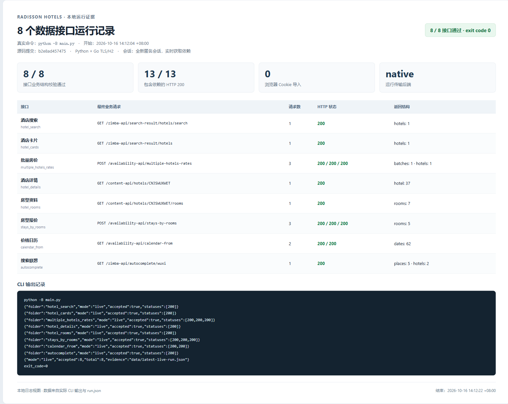
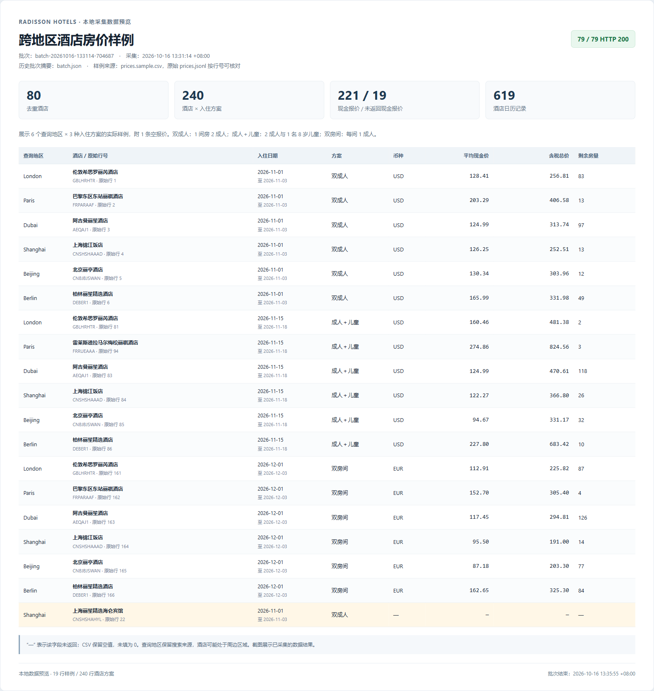

# Radisson Hotels

丽笙酒店的 8 个公开数据接口与批量采集脚本。Python 负责参数计算、解析和结果保存，Go 后端提供匹配浏览器特征的 TLS/HTTP2 连接与内存 Cookie 会话。

需要 **Python 3.10+、Go 1.26+**。Python 代码只使用标准库；首次运行自动编译 Go 后端并下载 go.mod/go.sum 锁定的依赖，后续复用本地程序。

## 运行

从仓库根目录进入案例：

```powershell
cd radissonhotels
python main.py
```

`main.py` 依次请求全部接口，也可以直接运行某个目录的入口：

```powershell
python stays_by_rooms/main.py
python autocomplete/main.py
```

修改对应目录的 `config.json`，设置酒店、日期、入住人数、儿童年龄、货币或搜索文字。日期为空时使用今天与明天。成功数据保存为该目录的 `response.json`，请求状态保存为 `last_run.json`；全量汇总在 `data/latest-live-run.json`。

| 目录 | 接口 | 内容 |
|---|---|---|
| `autocomplete` | GET /zimba-api/autocomplete/{text} | 地区与酒店联想 |
| `hotel_search` | GET /zimba-api/search-result/hotels/search | 酒店代码与距离 |
| `hotel_cards` | GET /zimba-api/search-result/hotels | 酒店卡片 |
| `multiple_hotels_rates` | POST /availability-api/multiple-hotels-rates | 批量房价 |
| `hotel_details` | GET /content-api/hotels/{code} | 酒店详情 |
| `hotel_rooms` | GET /content-api/hotels/{code}/rooms | 房型资料 |
| `stays_by_rooms` | POST /availability-api/stays-by-rooms | 房型报价 |
| `calendar_from` | GET /availability-api/calendar-from | 价格日历 |

## 批量采集

```powershell
python collect_batch.py
```

`batch_config.json` 设置城市、最多酒店数、日期和入住组合。输出为 `data/batch-时间/`，包含酒店、房价、详情、房型及日历 JSONL，另提供 `hotels.csv`、`prices.csv` 和 `calendar_prices.csv`。

酒店卡片按 20 家请求；批量房价按实时配置分批。缺失现金报价保留 null，CSV 中留空。每次运行创建新目录，汇总见 `data/latest-batch-run.json`。

## 参数与传输

`_common/parameters.py` 从前端实现恢复日期校验、入住人数、儿童年龄、房型去重、税费三态、分批与 Transactionid 等计算。live 模式通过当前 HTTP 会话获取公开配置、酒店分类和房型数据。

`_common/native_http/` 保留 Go 源码与依赖锁定文件。后端使用 tls-client v1.16.0 的 Chrome_152 配置，曾与本机 Chrome155 的已观察握手字段匹配。选择配置应以实际握手和业务响应为准，版本名称本身不代表完全相同的浏览器行为。

运行默认直连。`network_route` 可设为 `system` 读取系统代理，或设为 `proxy` 并提供本地 `proxy_url`；Cookie 和代理值只存在于运行会话中。

离线查看请求可运行 `python main.py --build`，使用 `_common/example_inputs.json` 中公开示例数据，不发送 HTTP。更换酒店后的公开依赖由 live 模式取得。

2026-10-16 实测：8 个接口三轮共 39 次 HTTP 全部 200；扩展采集 80 家酒店、3 组入住方案，79 次 HTTP 全部 200，得到 240 条酒店方案、619 条日历记录。19 条方案没有现金报价，保留为空。

## 采集证据

下面是本地运行日志和采集数据的截图。接口图对应当前发布代码的一次重新运行；数据图对应上述 80 家酒店的批次。





[运行摘要](evidence/run.json) · [CLI 输出](evidence/run.log) · [批量摘要](evidence/batch.json) · [19 行房价样例](evidence/prices.sample.csv) · [截图页面](evidence/index.html)

接口记录包含 13 次 HTTP 200 和 8 个接口的业务结构校验结果。房价样例覆盖 6 个查询地区与 3 种入住方案，并保留一条空报价；CSV 的 source_row 可对应原始价格 JSONL 行号。文件校验值见 [evidence/manifest.json](evidence/manifest.json)。
